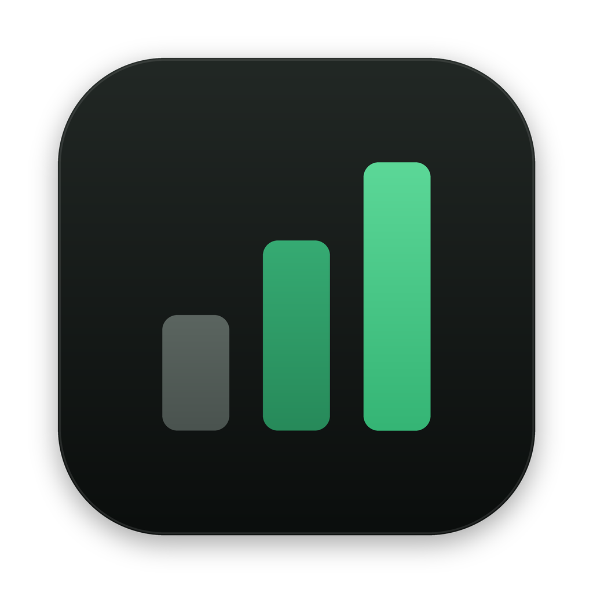
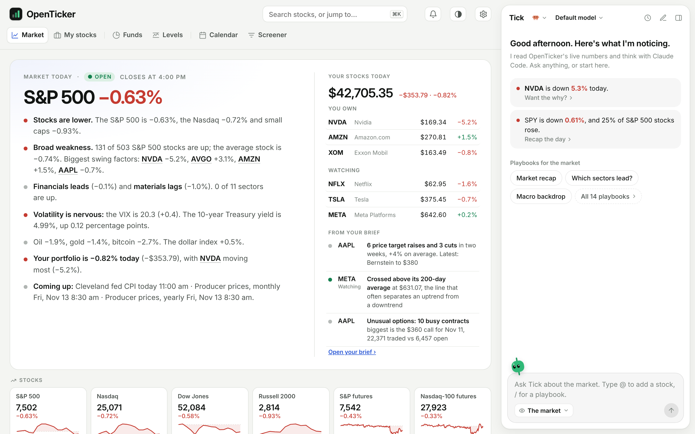

<p align="center"></p>

<h1 align="center">OpenTicker</h1>

<p align="center"><b>A stock market dashboard for your Mac, with your own AI agent built in.</b><br>
Live prices, what moved the market and why, your portfolio, earnings, analysts, insiders and options.<br>
Ask Claude Code, Codex, OpenCode or a local Ollama model about any of it, on the plan you already pay for.<br>
And when you want it to work differently, ask your agent to change it.</p>

<picture>
  <source media="(prefers-color-scheme: dark)" srcset="docs/screenshot-dark.png">
  
</picture>

<p align="center">
  <a href="#install">Install</a> ·
  <a href="#whats-inside">What's inside</a> ·
  <a href="#tick-your-analyst">Tick</a> ·
  <a href="#make-it-yours">Make it yours</a> ·
  <a href="#use-it-from-any-agent">Any agent</a> ·
  <a href="#commands">Commands</a> ·
  <a href="#privacy">Privacy</a>
</p>

## Install

**One line in Terminal:**

```bash
curl -fsSL https://raw.githubusercontent.com/bin01/openticker/main/install.sh | bash
```

**With Homebrew:**

```bash
brew tap bin01/openticker https://github.com/bin01/openticker
brew install openticker
openticker
```

**With your coding agent:** paste this into Claude Code, Codex or any agent:

> Install OpenTicker from github.com/bin01/openticker and follow its AGENTS.md.

Whichever you pick, OpenTicker installs to `~/.openticker`, runs in the background, adds **OpenTicker** to your Applications and opens it. It needs macOS 12 or later and sets up its own Python, so nothing else is required. It also runs on Linux, in your browser.

**On your phone too:** run `openticker start --lan`, then `openticker pair`, and open the link on your phone. It installs to your home screen.

## What's inside

| Page | What you see |
| --- | --- |
| **Market** | The day in plain English, then indexes, rates, the dollar, oil, the VIX and the 11 sectors |
| **My stocks** | Your watchlist and positions (typed in, imported from your broker's CSV, or kept in sync from Monarch, Interactive Brokers or Robinhood through their MCP servers, read-only) with gains and losses, how you're doing against the S&P 500, a brief of what changed, a portfolio X-ray, alerts that say why a stock moved, and a note on your phone at the close |
| **Any stock** | A chart with earnings and events marked, analysts, earnings history, ownership, options, financials and news |
| **Funds** | Which stocks drove SPY, QQQ, SMH and SPSM (small caps) over a day, a week or a year, holding by holding |
| **Levels** | Support and resistance, full screen: the S&P 500, VXX and the Nasdaq-100 across the top, any stock you pick below, on 5-minute to quarterly bars, with each level's strength and how far away it is |
| **Calendar** | Upcoming earnings and economic events |
| **Screener** | Yahoo's ready-made stock and fund ideas, a filter you build (size, valuation, growth, yield, 1-year change, sector), and Momentum signals: trend, strength and volume in one score |

Press <kbd>⌘K</kbd> or <kbd>/</kbd> to jump anywhere, and <kbd>⌘,</kbd> for Settings. Light and dark follow your Mac.

## Tick, your analyst

Press <kbd>A</kbd> or click **Ask Tick**. Tick hands your agent the live data for whatever you're looking at, so answers start from real numbers rather than memory, and it draws charts when a picture says it better. Pick the agent, model and effort from the top of the panel. Conversations are saved on your Mac.

| Agent | Billed to |
| --- | --- |
| [Claude Code](https://claude.com/claude-code) | Your Claude plan |
| [Codex](https://developers.openai.com/codex) | Your ChatGPT plan |
| [OpenCode](https://opencode.ai) | Whichever provider you signed it into |
| [Ollama](https://ollama.com) | Free, runs on your Mac |

If an agent isn't installed or signed in, Tick says so and opens Terminal with the official installer or sign-in. API keys in your environment are ignored so you're never billed twice. Set `OPENTICKER_AGENT_BILLING=api` if you'd rather use them.

### Playbooks

One click runs a playbook written for that question. Hover any insight and press <kbd>A</kbd> to ask about just that.

| Playbook | What you get |
| --- | --- |
| Quick take | The story of a stock in 200 words: trend, analysts, what's next |
| Deep dive | The business, where its growth comes from, and what the price assumes |
| Why is it moving? | Market, sector or company news, sized against a normal day |
| Earnings | Before a report: the bar to beat and the move options price in. After: what happened and how the stock took it |
| Read the chart | Trend, momentum, volume, and the support and resistance levels that matter |
| Insider trades | Who's buying or selling, how much of their stake, and whether it means anything |
| Bull vs bear | Both cases from the numbers, and what would prove each right |
| What analysts say | Ratings, targets and estimate revisions, and their direction |
| Is it expensive? | Multiples against growth, its own history and peers |
| Check up on my portfolio | Concentration, sector tilt, what's driving returns, what's next |
| What to watch this week | Earnings and economic data that matter for your stocks |
| Market recap | What the market did and why, in plain English |
| Which sectors lead? | Leaders and laggards across sectors, and what the shift says |
| Macro backdrop | Rates, the dollar, oil and the VIX, and what they mean for stocks |

Playbooks are plain [Agent Skills](https://agentskills.io) in `skills/`. Read them, edit them, or ask your agent to write a new one.

## Make it yours

OpenTicker is built to be changed by your coding agent, no programming needed. Describe what you want:

```bash
openticker edit "add XLE and XLF to the Funds page"
openticker edit "make Tick answer in bullet points"
openticker edit "add a playbook that compares a stock with its two closest rivals"
openticker edit "alert me when a stock in my watchlist drops 5% in a day"
```

That opens Claude Code, Codex or OpenCode in OpenTicker's code. Or go to **Settings → About → Change OpenTicker**, or open `~/.openticker` in any agent.

Your agent reads [AGENTS.md](AGENTS.md), which maps the code and has recipes for common changes. It makes the change, checks it with `openticker check`, restarts, looks at the result with `openticker shot`, and saves it as a commit. When you run `openticker update`, your changes are replayed on top of the new version. If the two ever clash, update stops without touching anything and tells you to run `openticker edit` to sort it out.

## Use it from any agent

OpenTicker's data works outside the app too, in whatever agent you already use.

**The command** prints Markdown that agents read well:

```bash
openticker stock NVDA              # company, price and trend, analysts, earnings, insiders, options, news
openticker earnings NVDA           # one section: analysts, earnings, ownership, options, news, financials, events
openticker technicals NVDA         # trend, RSI, MACD, volume, support and resistance
openticker insiders NVDA           # insider buying and selling in depth
openticker portfolio               # your positions, watchlist and what changed
openticker market                  # indexes, sectors, macro and today's movers
openticker fund SMH --h 1M         # what drove a fund
openticker compare NVDA AMD AVGO
openticker history NVDA SMH --h 3M # daily closes, for charts
openticker calendar
```

**Skills.** Setup installs the playbooks for Claude Code (`~/.claude/skills`) and for Codex, Cursor, OpenCode and others (`~/.agents/skills`). Run `openticker skills install` to refresh them. They're also a Claude Code plugin:

```
/plugin marketplace add bin01/openticker
/plugin install openticker@openticker
```

**MCP.** `openticker mcp` is a stdio MCP server with read-only tools (`stock`, `stock_section`, `portfolio`, `brief`, `market`, `fund`, `compare`, `history`, `calendar`, `search`) and the playbooks as prompts. For Claude Desktop, Cursor or any MCP client:

```json
{ "mcpServers": { "openticker": { "command": "openticker", "args": ["mcp"] } } }
```

## Commands

| Command | What it does |
| --- | --- |
| `openticker open` | Open the app |
| `openticker start [--lan\|--local]` | Run in the background and at login; `--lan` lets your phone connect |
| `openticker stop`, `restart`, `status`, `logs` | Control the background server |
| `openticker pair` | A link for your phone, including Tick |
| `openticker update` | Get the latest version, keep your changes, restart |
| `openticker doctor` | Check Python, the server, the Mac app and your agents |
| `openticker edit ["what you want"]` | Open your coding agent in OpenTicker's code |
| `openticker check` | Fast checks after a change, including the tests |
| `openticker test [-v]` | Just the tests: the math behind every number |
| `openticker shot [page\|TICKER] [--dark\|--light] [--phone] [--out FILE]` | Screenshot a page and print where it saved |
| `openticker accounts` | Your linked brokerages and when they last synced |
| `openticker sync` | Sync linked brokerages now (they also sync after each trading day's close) |
| `openticker skills [install]` | List the playbooks, or install them for your agents |
| `openticker mcp` | Run as an MCP server |

`openticker help` lists everything, including all the data commands.

## Privacy

Everything runs on your Mac. Your watchlist, positions, alerts and Tick conversations live in `~/Library/Application Support/OpenTicker` and never leave it. Market data comes from Yahoo Finance. When you ask Tick something, the question and the data for what you're looking at go to the agent you chose, under that agent's terms. Only this Mac, or a phone you paired, can use Tick.

OpenTicker uses Yahoo Finance's public data through [yfinance](https://github.com/ranaroussi/yfinance) and fund holdings published by State Street, Invesco and VanEck. It's for personal research and isn't affiliated with any of them. Data can be delayed or wrong, and nothing here is investment advice.

## Contributing

OpenTicker is a small Python server (standard library plus yfinance, pandas and openpyxl, which reads the fund issuers' Excel files) and plain HTML, CSS and JavaScript with no build step. The Mac app is one Swift file. [AGENTS.md](AGENTS.md) maps the code and the house rules, for people and agents alike.

```bash
git clone https://github.com/bin01/openticker && cd openticker
./install.sh            # installs from this checkout
openticker check        # after a change
```

## License

[Apache 2.0](LICENSE). Inter is by Rasmus Andersson under the [SIL Open Font License](app/static/fonts/ofl-inter.txt).
